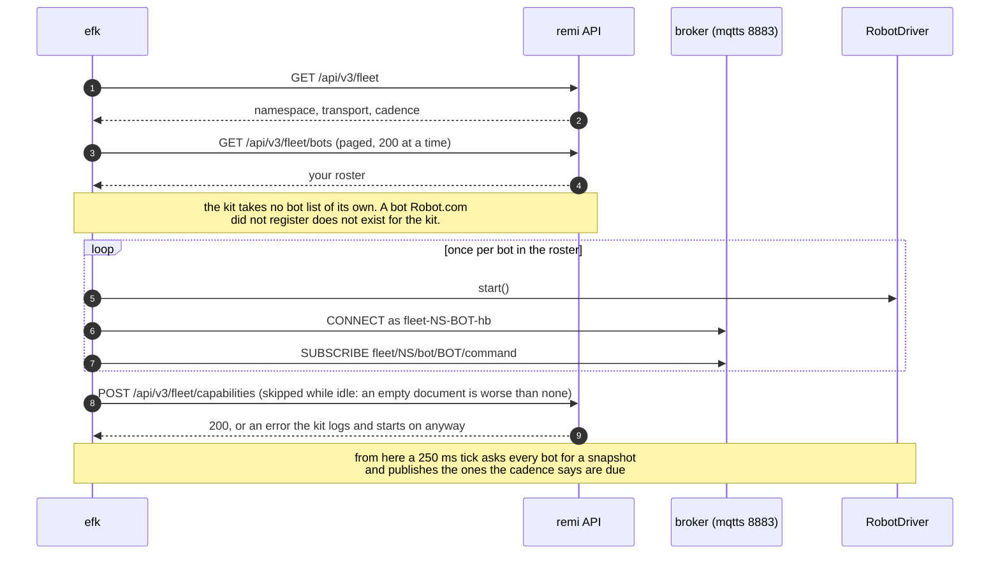
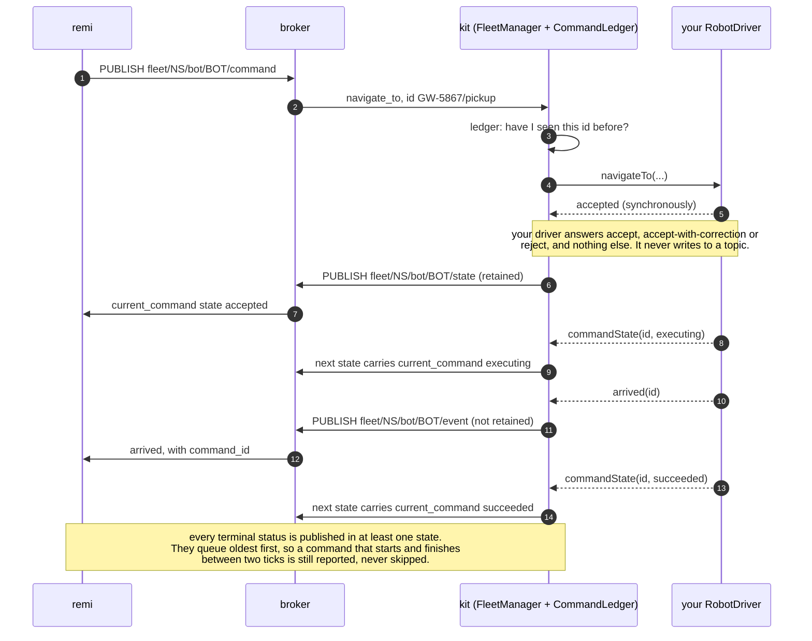
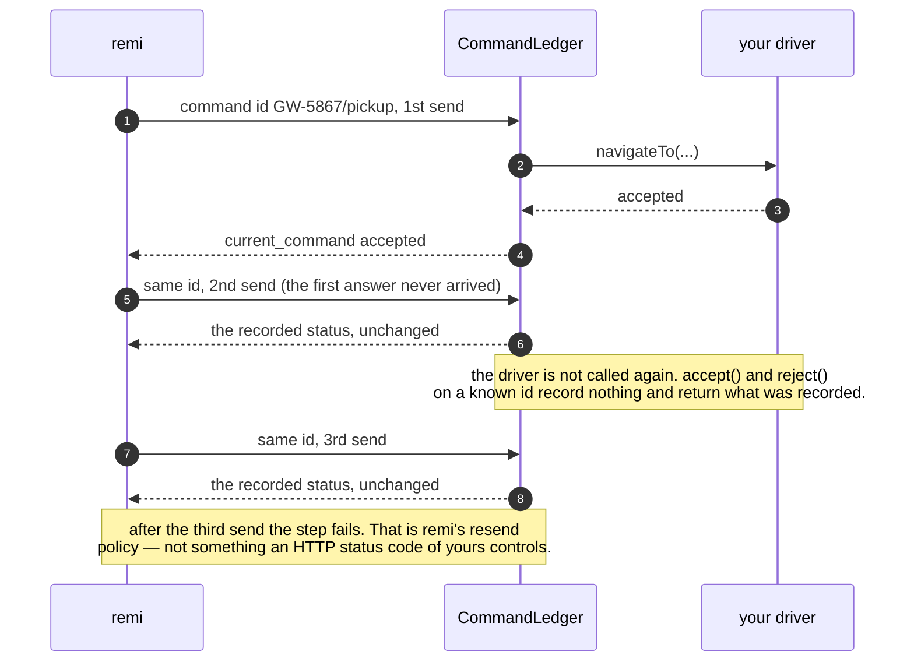
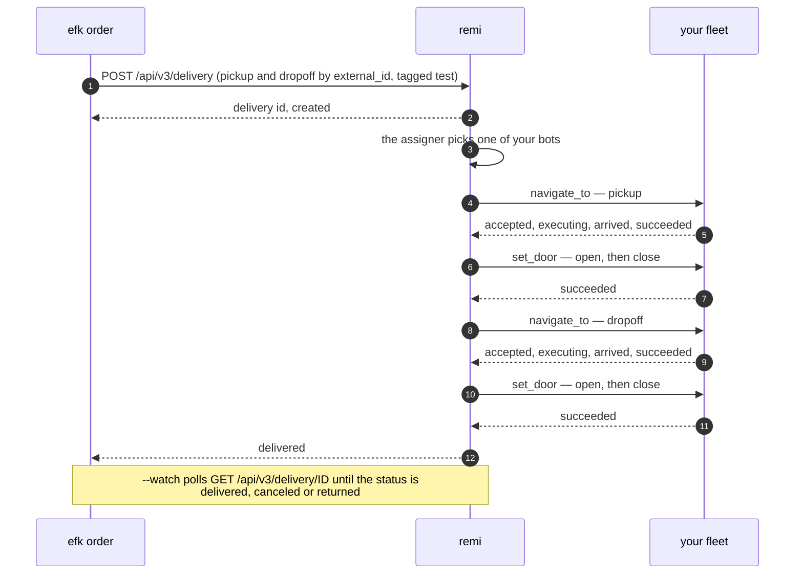
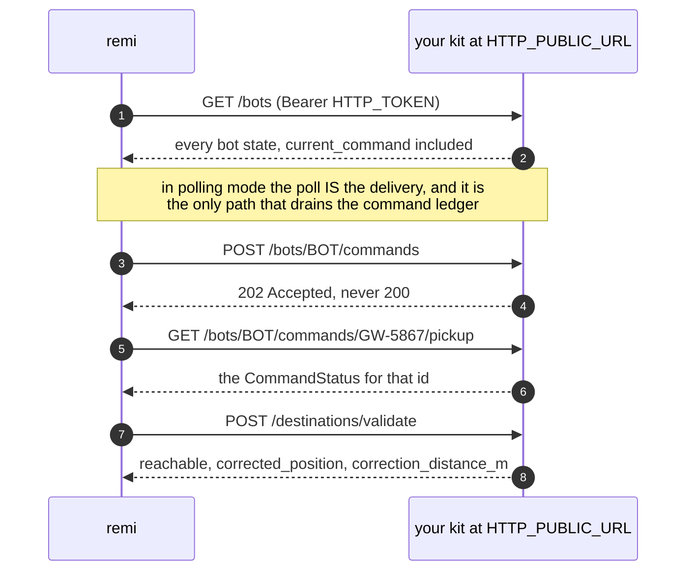

# external-fleet-kit (`efk`)

A reference **fleet manager** for remi's [External Fleets contract](https://remi.kiwi/docs/external-fleets), with simulated robots included.

Clone it, drop in the `.env` Robot.com sent you, run it: your simulated bots show up in remi, get dispatched by the same assigner that runs Robot.com's own fleet, and complete deliveries. When you are ready for real robots, implement one interface (`RobotDriver`) and nothing else changes.

> **Status:** `0.x`. Frozen against contract `2026-09`. `1.0.0` is tagged once the full end-to-end run against remi (order created → delivered) is on record.

## What it is, in one picture

```
 remi ──(contract: state / commands / events)──▶ FleetManager ──(RobotDriver)──▶ your robots
                                                 │  ├─ CommandLedger  (idempotency, CommandStatus)
                                                 │  ├─ Cadence        (when to publish)
                                                 │  └─ BotRuntime ×N  (one per bot in your roster)
                                                 ├─ Transport: MQTT (default) or HTTP
                                                 └─ observers: TUI · web dashboard · log
```

The core speaks the contract upwards and `RobotDriver` downwards. It never sees your robot API; your driver never sees a topic, an HTTP status or a `BotState`.

## Requirements

- Node 22 LTS, pnpm 9.
- The `.env` Robot.com sent you (see below). Nothing else: no account, no registration calls. Robot.com provisions your fleet before you receive the file.
- MQTT mode (default): outbound TLS to the broker on port 8883. HTTP mode: a public `https` URL remi can reach (see *HTTP mode*).

```bash
git clone <this repo> && cd external-fleet-kit
pnpm install
cp /path/to/the/.env/you/received .env
pnpm efk check
pnpm efk start
```

## The `.env` you receive

Robot.com generates it; you only fill in `MQTT_PASSWORD` if it was sent separately. Treat it as a credential: it contains a production API key.

| Variable | Meaning |
|---|---|
| `REMI_API_URL` | remi's API host |
| `REMI_API_KEY` | your key (`live_sk_` + 48 hex), scopes `fleet` + `delivery`, bound to your namespace |
| `REMI_TRANSPORT` | `mqtt` (default) or `http` |
| `MQTT_HOST`, `MQTT_PORT`, `MQTT_USERNAME`, `MQTT_PASSWORD` | broker credentials for your fleet (`mqtts`, 8883) |
| `HTTP_TOKEN`, `HTTP_PORT`, `HTTP_PUBLIC_URL` | HTTP mode only: the Bearer token remi sends you, the local port, and the public `https` URL remi calls. In the `.env` you receive these three are commented out and **replace** the MQTT block above, they are not added to it |
| `SANDBOX_LOCATION_ID` | **optional** — your sandbox location; your bots are placed there. `efk order` needs it |
| `SANDBOX_CENTER_LAT`, `SANDBOX_CENTER_LNG` | **optional** — where simulated bots appear (remi never sends positions to a partner). The simulated driver needs them; a real driver ignores them |
| `SANDBOX_PICKUP_EXTERNAL_ID`, `SANDBOX_DROPOFF_EXTERNAL_ID` | the sandbox points `efk order` uses |
| `WEB_PORT` | local dashboard port (4310) |
| `HTTP_PUSH`, `LOG_LEVEL`, `EFK_SCENARIO` | optional, kit-only: push state instead of being polled (HTTP mode); log level; which bundled scenario the simulated driver runs (`--scenario` sets it) |

Two things about that file that cost people an afternoon if nobody says them:

- **`MQTT_PASSWORD` arrives empty on purpose.** Provisioning hands the broker password over out of band, so the line is present and blank in the file you receive, and the schema accepts it blank — a `.env` that failed to parse here would turn "you still have to paste the broker password" into "your `.env` is broken". `efk check` C1 is what tells you to paste it, with the runbook step.
- **The `SANDBOX_*` block describes a test sandbox, and a production fleet has none.** Leave it out and `efk start` runs your driver without it. An *empty* value counts as absent, never as zero: a half-filled `SANDBOX_CENTER_LAT=` would otherwise read as latitude 0, off the coast of Africa, and the fleet would be placed there silently.
- **`HTTP_PUSH=1` does not mean true.** Only the literal string `true` (any casing) enables push; `1`, `yes` and `on` all read as `false`, silently. The same goes for every other boolean in the file.

The kit **does not** take a list of bots: it reads your roster from `GET /api/v3/fleet/bots`. A bot Robot.com did not register does not exist for the kit.

## `efk check` — does my integration meet the contract?

```
efk check [--json] [--demo]
```

Nine rules, each `PASS`, `WARN`, `FAIL` or `SKIP`, each with a plain-language fix. Exit code 1 on any `FAIL`. Read-only: it publishes nothing and creates nothing.

| # | Rule | What a FAIL means |
|---|---|---|
| C1 | `.env` parses and is complete | copy the file Robot.com sent you; the message names the missing variable. `MQTT_PASSWORD` arrives separately, so the commonest FAIL here is "it is empty: paste the broker credential" |
| C2 | `GET /api/v3/fleet` answers and matches your `.env` | 401: bad key · 403: key lacks `fleet` · 404 `FLEET_NOT_CONFIGURED`: Robot.com has not configured your fleet yet · transport or namespace mismatch (your `MQTT_USERNAME` implies a namespace remi does not agree with) · demo mode active · WARN if the contract version differs from the kit's |
| C3 | roster is non-empty, ids are well-formed, bots sit in your sandbox location (only checked when `SANDBOX_LOCATION_ID` is set); judged on the same selection `efk start` drives (retired rows out, `max_bots` applied) | 0 bots: Robot.com has not registered them yet · the fleet requires `fleet_serial` and a bot has none · WARN per bot not yet placed |
| C4 | `blocked_by` per bot, explained | never FAIL: only meaningful while `efk start` runs (`efk start --check` runs it after 10 s) |
| C5 | MQTT CONNECT + SUBSCRIBE with a diagnostic client id (`fleet-<ns>-check-<random>-hb`) | credential or client id refused · WARN if the broker downgraded the subscription to QoS 0 |
| C6 | HTTP mode: `GET HTTP_PUBLIC_URL/bots` with your token returns every bot | always at most WARN: this proves your server is up, **not** that remi can reach it |
| C7 | the key has the `delivery` scope (`GET /api/v3/delivery/?limit=1`) | WARN: you can simulate but `efk order` will not work; ask Robot.com |
| C8 | the frozen samples still validate against the vendored schemas | the kit itself is inconsistent; open an issue |
| C9 | `efk.config.ts` loads; a driver is built **for every bot in your roster**, with the same `fleetSerial` `efk start` passes (never started; SKIP while the factory's `unavailable()` says it cannot build yet) and each is `driverVersion: 1`, declares capabilities and `validateDestination` | update your driver to v1 · WARN if a driver declares a door but not `set_door`, or if a scenario override names a bot you do not have |

Paste the nine lines into any support request. `--json` prints the same report as JSON — it contains no secrets, so it is safe to attach.

## `efk start` — run the fleet

```
efk start [--scenario <name>] [--web] [--web-host <host>] [--headless] [--check] [--demo]
```

- One MQTT connection per bot (client id `fleet-<ns>-<bot_id>-hb`), retained `state`, `event` unretained, `command` subscribed — exactly as the contract's *MQTT mode* section asks. Capabilities are not a topic: the kit sends the document to remi at start-up, and again only when the fleet changes it (see below).
- The TUI shows **BOTS** (link, availability, battery, door, current command, age of last state, `seq`, dropped states), **COMMANDS** (newest first; resends of the same id are one row with `×N`; the *echo* column is the time from receiving a command to publishing the first state that carries it in `current_command`), **EVENTS** and **LOG**. `Tab`/`←`/`→` switch sections, `↑`/`↓` select a bot, `q` quits.
- Manual fault keys on the selected bot (simulated driver only): `a` toggle `available`, `d` open/close the door locally (the human of `manual_close_door`), `o` cycle the link (scenario → pinned down → pinned up → back to the scenario; a `*` in the row means you are holding it), `b` blocked/unblocked.
- `--web` serves the same four views at `http://127.0.0.1:4310` (SSE, no framework, no map), plus the same manual fault controls the TUI has — available/door/link/blocked — as four `POST /api/bots/:botId/controls/*` routes. This is a deliberate break of design §8 ("TUI, web and log are observers of the bus; no logic lives in them"): the TUI already broke it (manual fault keys), and the web now does too, on purpose, sharing the same extracted logic (`src/core/manual-controls.ts`) so the two interfaces cannot diverge. It binds to loopback by default; **the control routes are only *mounted* when the dashboard is bound to loopback** — on any other host they do not exist (a request 404s, it is not "present but refused") — because this repository is public, so the shape of every endpoint is public knowledge and a startup warning protects nothing. `--web-host 0.0.0.0` still exposes the read-only views and still warns, but now says plainly that state is visible to the network while the controls stay disabled.
- `--headless` disables the TUI (Docker, CI) and every line the running fleet produces goes to stderr as JSON — one per event, not just the startup banner. The few sentences that *refuse* a start (an unparseable `.env`, a held lock, a port already taken) and the demo banner stay plain prose, because there is no fleet yet to report on.
- A second `efk start` in the same directory refuses to run (`.efk.lock`): two instances would publish conflicting `seq`. **The design is single-instance**: one process per fleet. Two replicas behind a load balancer would each keep their own `seq` counters and command ledger, and remi would discard half the states as stale and see commands its sender never accepted. If you deploy it, deploy one replica with a strategy that stops the old one before starting the new (Kubernetes: `replicas: 1`, `strategy: Recreate`, and a `ReadWriteOncePod` volume — `ReadWriteOnce` limits by *node*, not by pod).
- **An empty roster, or a driver that is not configured yet, is an idle start, not a refusal.** The fleet comes up with no bots, says once what is missing, and publishes nothing. A roster fills itself within 15 s of Robot.com registering the bots (see below); a driver that reports itself unconfigured (`DriverFactory.unavailable()`, typically your own API credentials) needs the `.env` fixed and a restart. That is the normal state of a fresh deployment: the bots are registered in remi on the day of the onboarding, and your credentials arrive when they arrive.

What `efk start` actually does, in order — note that the roster comes from remi, not from your config:



**The roster is not frozen at startup.** Every 15 s the kit reads `GET /api/v3/fleet` and `GET /api/v3/fleet/bots` again and follows what changed: a bot Robot.com registered starts being driven, a bot they retired stops, and a bot whose `fleet_serial` moved is rebuilt against the robot it now names. Only the bots that changed are touched — everything else keeps its runtime, its command ledger and its driver, so a fleet that is delivering does not notice. Two things it never does on a refresh: park a fleet that is already driving (an undriveable bot is skipped and logged, not a reason to take the others off the road), and rebuild a bot that is running a command (the change waits for the next pass). If remi is unreachable the pass is skipped and the current roster keeps driving. The capabilities document is re-sent only when it changed, and never from an idle fleet: a document that says `has_door: false` makes remi drop every `set_door` and turn `manual_close_door` on for every bot, one-way. What still needs a restart is the `.env`: credentials and transport are read once, by design.

**`fleet_serial`.** remi may map a bot to the id your own system uses for that robot (`fleet_serial` on each roster row). The driver factory receives it as `env.fleetSerial`; `null` means the original rule, where your serial is the bot id minus the fleet prefix. When remi marks the fleet `requires_fleet_serial` — its bot ids are internal, so stripping the prefix would address the wrong robot — a bot with no mapping parks the whole fleet at start (idle, said once), rather than driving 49 robots of 50 and stranding the order that lands on the missing one. A refresh only skips it.

## The command round trip

There is **no reply message**. remi sends a command; the answer travels back inside the next `BotState`, in `current_command`. This is the single thing most worth understanding before you write a driver:



The gap between the command arriving and the first state that carries it is what the TUI calls the *echo*.

### Why your driver never sees the same command twice

remi sends a command up to **three times**. The ledger, not your driver, is what makes that safe:



A `throw` from your driver is the one case that leaves no record: it answers `503` with `DRIVER_ERROR` in HTTP and leaves `current_command` untouched in MQTT, so remi simply resends the same id under that same policy.

## `efk order` — create a test delivery

```
efk order create [--name <n>] [--watch]
efk order watch <delivery id>
```

Creates a delivery on your sandbox between `SANDBOX_PICKUP_EXTERNAL_ID` and `SANDBOX_DROPOFF_EXTERNAL_ID` (tagged `test`), and follows it until `delivered`. Needs the `delivery` scope (C7). Watch the TUI: `navigate_to` → `accepted` → `executing` → `succeeded`, `set_door`, the second leg, `delivered`.



It is the same assigner that dispatches Robot.com's own fleet: nothing in that diagram is a path built for partners.

## Scenarios — what each knob reproduces

`efk start --scenario <name>` loads `scenarios/<name>.json`. `{}` is the default: bots online, available, 100 %, full door, they arrive and echo. Every field has a default; `overrides` are per bot id, and an override only changes the keys it mentions — siblings at every level are kept.

> **The bundled scenarios use our example fleet's ids (`ACME-0001`…).** Your roster is almost certainly different, and an override keyed on a bot you do not have does nothing at all. Edit the ids to match yours. `efk start` warns about stray ids at startup and `efk check` C9 lists them.

| Knob | Reproduces | What you see in the kit | What you should see in remi |
|---|---|---|---|
| `link.mode: offline` | link to the robot lost | `connected: false`; in MQTT the bot's connection really closes | `blocked_by: ["disconnected"]`, never assigned |
| `link.mode: flapping` | intermittent link | connection up/down every `flapPeriodMs` | `connected` alternates; a running job survives if the bot is back before the engine's timeout |
| `battery.startPct: 15` | low battery | `battery.percentage: 15` | `blocked_by: ["battery_below_minimum"]`; exactly 20 is still eligible |
| `battery.unavailableBelowPct: 30` | you pull the bot before remi does | `available: false` past the threshold | `blocked_by: ["unavailable"]` |
| `door.mode: boolean` | a lid that only says open/closed | door jumps `closed` → `opened`, no transients | remi's bridge synthesises `opening`/`closing`; load/unload completes |
| `door.mode: stalled` | jammed door | the door reports `stalled` on the next tick after `set_door` and stays there — it jams the instant it is asked to move, it does not time out first | the door step fails immediately |
| `door.mode: ignore` | door does not react | no state change | remi's 25 s door timeout, then an operator task |
| `door.hasDoor: false` | no door | `door: "unsupported"`, `has_door: false` | remi should not send `set_door` |
| `motion.arrive: never` | arrives to 1 m and never confirms | `executing` forever, 1 m short | the job does not advance until remi's position fallback (if enabled on the location) |
| `motion.arrive: stall` | gives up mid-route | stops at 60 % | `step-bot-not-moving` or a step timeout |
| `motion.ackGoals: false` | lost echo | command never appears in `current_command`; the bot still moves | remi resends the same id every 10 s, 3 sends in total, then fails the step; the TUI groups the three |
| `fleet.supportsCommandInterrupt: false` (in `efk.config.ts`) | API that rejects a second mission | second `navigate_to` while executing → `BOT_BUSY` | **the job step fails** — read the warning below before you declare this. Only observable once remi reads your capabilities document |
| `destinations.snapGridDeg: 0.0002` | you correct destinations onto your drivable network | `accepted_with_correction` (only when the point actually moved), `distanceM` 0–15 m | HTTP: 202 with `corrected_position`; MQTT: `current_command.corrected_position`; remi records it against the point, does not resend |
| `destinations.unreachableBeyondM: 300` | destination out of service area (measured from the sandbox centre, so the answer is idempotent) | `rejected: DESTINATION_UNREACHABLE` with `correctionDistanceM` | HTTP 422 / MQTT `current_command.state: "rejected"` with `error.code` and `correction_distance_m`; remi fails the step, alerts an operator, does not retry |
| `motion.noise.*: 0` | a "perfect" robot | exact track at 1.5 m/s | good for ETA measurements |

> ### ⚠️ `supports_command_interrupt: false` is not handled by remi yet
>
> The contract's intended answer to a fleet that cannot interrupt is that remi cancels the running navigation first and re-sends, with no mid-route reassignment. **That branch is not implemented in remi today.** It is a deliberate deferral to a later release, not an oversight and not a bug you can report.
>
> Until it ships, what actually happens is this: the second `navigate_to` of a job is rejected with `BOT_BUSY`, remi does not cancel-then-retry, and **the job step fails**. On a real delivery that is a robot left holding an order.
>
> So: declare `false` only if your API genuinely rejects a second mission while one is running — and when you do, tell Robot.com, and expect reassignments to fail until remi's cancel-first branch is released. Do **not** declare `false` on the strength of behaviour that does not exist yet.

**`correction_distance_m` means one thing in both cases: the distance from the destination you asked for to the nearest point this fleet can actually drive to.** Reachable → that point is the corrected one, so the number is the size of the correction. Unreachable → that point is the closest one inside the service area, so the number is how far past the edge the request fell. The service area is checked **after** the correction, because the corrected point is where the robot would stop.

Shipped scenarios: `default`, `boolean-door`, `low-battery`, `offline-flapping`, `never-arrives`, `no-interrupt`, `destination-correction`. `efk scenarios list` prints them, one line each, with what each one does.

**`no-interrupt` is deliberately inert.** Parsed, that file is identical to `default`: the knob its name promises — `supports_command_interrupt` — is a *fleet* capability that lives in `efk.config.ts`, not a per-bot scenario field, so there is nothing for the JSON to say. It is kept, and named, because that is where a partner looks for it. `efk scenarios list` prints the same explanation next to it. To see the behaviour, set `fleet.supportsCommandInterrupt: false` in `efk.config.ts` — and read the warning above first.

## From simulator to your robots: implementing `RobotDriver`

1. Copy `src/driver/template/my-robot-driver.ts` to `src/driver/my-robot-driver.ts` and replace each `TODO` with calls into your fleet API.
2. In `efk.config.ts` replace `driver: simulated({ scenario: ... })` with `driver: (botId) => new MyRobotDriver(botId)`. The factory's second argument carries `fleetSerial` (see *`efk start`*), and the factory may have an `unavailable()` that answers a sentence while it cannot build drivers — missing API credentials — so the fleet starts idle instead of throwing once per robot.
3. `pnpm efk check` (C9 validates your driver), then `pnpm efk start`.

The contract of the interface (`src/driver/robot-driver.ts`, version 1):

- `snapshot()` is called four times a second and must be cheap. Return `position: null` while you do not know where the robot is: the kit will not publish a state without a position (remi would score it), and counts the drop. **Do not repeat an old fix as current**: every state goes out with the kit's timestamp, so a cached position reads to remi as "connected, right here" for as long as you keep returning it. Hold it through a short telemetry gap, then return `null` or `connected: false`.
- `available` is your API's own "can take work", one to one. Do not fold connectivity or the age of your reading into it: remi derives both on its side, and a third opinion only creates disagreement.
- Two optional snapshot fields: `azimuth` (compass bearing, degrees from North, clockwise) travels as `position.azimuth`, and `outOfService` as `out_of_service` (remi parks the bot `off_duty`, one-way). Leave them out if your API cannot tell; the kit then leaves them out of the state.
- `navigateTo`, `cancelNavigation`, `setDoor` answer **synchronously** with `accepted`, `accepted_with_correction { position, distanceM }` or `rejected { code, message }`; then emit `commandState(id, 'executing' | 'succeeded' | 'failed')` and `arrived(id)`. Never call back with an id you did not accept.
- Idempotency, `seq`, `current_command`, cadence, transport, retries: **not yours**. The kit never sends the same command id to your driver twice.
- `validateDestination(position)` answers `POST /destinations/validate` in HTTP mode. The default returns the point unchanged; override it if your network snaps destinations. remi does not call this endpoint in the current release (the point registry that used it was retired), so nothing depends on it today.
- `supports_command_interrupt` is fleet-wide, in `efk.config.ts`. Declare `false` if your API rejects a second mission while one runs: a wrong `true` strands a job — and, until remi's cancel-first branch ships, so does a correct `false`, because remi does not yet cancel and re-send. See the warning under *Scenarios*.
- A `throw` from any method is reported as `DRIVER_ERROR`. **This is an extension of this kit, not part of the contract**: the External Fleets page declares no such code and states no policy for 5xx. What it does say is that remi sends a command up to **3 times**. So a `throw` means *no answer*: HTTP gets a 503 whose body carries `"code": "DRIVER_ERROR"`, and in MQTT `current_command` is left untouched — in both cases remi simply resends the same `id` under its existing resend policy, and after the third send the step fails. Do not read the 503 as "remi will retry because of the status": it retries because of the resend policy, and only twice more.
- **Throw only what a resend can fix.** That follows from the previous point: a transient refusal of your API ("busy, retry", a request with that key still in progress, a timeout) and your own bugs are throws. A failure that is deterministic for that command — robot not found, idempotency key reused, action not supported — gets the same answer on all three sends and the delivery dies with no terminal `current_command`. Return `rejected` for it (`UNSUPPORTED_COMMAND` when no other code fits) with your API's error in the message.
- **Your API's idempotency may not be uniform, and the kit cannot hide that.** The kit never hands your driver the same command twice, but your driver may retry its own calls. Check each endpoint: it is common for "create mission" to replay a repeated key while "cancel" or "open lid" act on it again, or for a check endpoint not to take a key at all. Likewise, an action the robot never confirms (a lid that reports nothing back) is not done because the call returned 2xx: read the result from telemetry.
- **Log your API's mission id next to remi's command id.** When an outcome looks wrong — "succeeded" far from the destination — that id is the only thing your own support can look up.

## Kit vocabulary that is not in the contract

Three error codes in this kit are the kit's own. The contract does not declare them, another partner's fleet will not emit them, and remi attaches no behaviour to them. They exist because the contract leaves `error.code` free-form on a `failed` `CommandStatus` and constrains it only on a `rejected`.

| Value | Where you see it | What it means |
|---|---|---|
| `DRIVER_ERROR` | HTTP: the `code` of a `503` RFC 7807 body. MQTT: nowhere — `current_command` is left untouched | your driver threw. Never a `CommandStatus.state`, never a rejection code |
| `SUPERSEDED` | `error.code` on a `failed` status, for a navigation displaced by a newer `navigate_to` | the older command will not finish; the newer one owns the bot |
| `CANCELLED` | `error.code` on a `failed` status, for the navigation a `cancel_navigation` ended | the contract has no "cancelled" state, so the kit closes the entry itself rather than leave it `executing` for ever |

The contract's own rejection codes are the four `CommandStatus` allows on a `rejected`: `UNSUPPORTED_COMMAND`, `COMMAND_EXPIRED`, `BOT_BUSY`, `DESTINATION_UNREACHABLE`. Branch on those. (`REPLACED` never leaves the process: it is the command ledger's internal marker, rendered on the wire as `SUPERSEDED`.)

## Log redaction — and why it also decides what remi sees

`efk start` builds the logger with the three credentials from your `.env` (`REMI_API_KEY`, `MQTT_PASSWORD`, `HTTP_TOKEN`) and redacts two ways: by **key** — `authorization`, `password`, `token`, `apiKey`, `secret` and the `.env` names, matched at any depth and ignoring case, `_` and `-` — and by **value**, replacing every spelling those three secrets can take in serialized text (raw, JSON-escaped, `encodeURIComponent`, `encodeURI`, form-encoded, and base64 at all three byte alignments, which is what catches a password inside an `Authorization: Basic` blob).

**It is not only a logging path.** Redaction happens once, at the event bus, and the fleet manager republishes driver events **to remi** off that same bus — emitting before it publishes. So what remi receives is the redacted copy, `detail` included, and `detail` comes straight from your driver. Anything the redactor changes here, it changes on the way out.

Because of that it is fail-closed, and fail-closed means it can over-redact. Three cases, all deliberate:

- **A secret shorter than 4 characters is dropped from value scrubbing entirely.** A needle that short matches so much innocent text that it would blank whole lines. A 3-character credential is a provisioning bug to fix, not something to redact around.
- **A password that is an ordinary word blanks that word everywhere.** Value scrubbing is substring replacement over already-serialized text; it has no way to know which occurrence was the credential. If your `MQTT_PASSWORD` is `robot`, every `robot` in every log line — and in every event `detail` republished to remi — becomes `[redacted]`. Use a random broker password.
- **Anything nested deeper than 12 levels is replaced wholesale** with `[redacted]`, rather than passed through unexamined. A reference pointing back into its own ancestry becomes `[circular]`; a shared reference that sits inside the bound is preserved in full, not collapsed.

If a log line or an event `detail` looks mangled, one of those three is why. The kit is not broken.

## HTTP mode and the public URL

Set `REMI_TRANSPORT=http`. The kit serves the four partner endpoints (`GET /bots`, `POST /bots/:bot_id/commands`, `GET /bots/:bot_id/commands/:command_id`, `POST /destinations/validate`) on `0.0.0.0:HTTP_PORT` with your `HTTP_TOKEN`, answers 202 (never 200) and RFC 7807 errors. `GET /healthz` is the one unauthenticated route (see [Running it in a container](#running-it-in-a-container)). Capabilities are not one of these: the kit sends that document to remi with `POST /api/v3/fleet/capabilities` (see `efk start` above), not served or polled. **remi has to reach `HTTP_PUBLIC_URL` over `https`**: a laptop needs a tunnel or a deployment. C6 can only tell you that your server is up; it cannot prove remi reaches it, which is why it is a `WARN` even when green. `HTTP_PUSH=true` pushes state and events to remi instead of waiting to be polled.



One shape to copy rather than re-derive: remi forms a command id as `<job id>/<step>` (`GW-5867/pickup`), so **a command id contains a slash**. The status route is therefore a wildcard (`/bots/:bot_id/commands/*`) and the id is the rest of the path, read with no second `decodeURIComponent` — decoding twice turns a `%2F` that is genuinely part of an id into a separator.

## Running it in a container

`docker build -t my-fleet:dev .` builds one image that runs `efk start --headless` on port `4300`. The install is `--prod=false` on purpose: the kit has no build step, it runs on `tsx`, which is a devDependency, and a production install gives an image that cannot execute a line.

There is no `.env` in the image. Every variable of [the `.env` you receive](#the-env-you-receive) is read from the environment (`efk` merges `process.env` over the file, and the file is simply absent), so the deployment supplies them as a secret. One variable exists only here:

- **`EFK_STATE_DIR`** (`/state` in the image) — where `.efk.lock` and `.efk-state.json` are written. `/app` is immutable, and the `seq` counters must survive a restart: a counter that resets to 1 makes remi discard every state that follows as older than what it already has. Mount a volume there.

The entrypoint removes a leftover `.efk.lock` before starting. Its owner-is-alive check cannot work across containers — pid 1 always exists in a fresh one — so a lock left by a killed predecessor would refuse every restart for ever. That is safe **only** with one replica and a strategy that stops the old container first (see *single-instance* under `efk start`); with two replicas the lock would be doing its job and deleting it would be the bug.

`GET /healthz` (HTTP mode) is served **without** the bearer token, because a load balancer's health probe usually sends no headers; every other route still requires it. It answers `{"ok":true}` **unconditionally**: the process is listening, nothing more. It is not a deployment gate — an idle fleet with no credentials answers the same 200 as a working one. Read the logs, or run `efk check`, to know whether the fleet is actually driving robots.

## How the contract is kept in sync

`src/contract/` is a vendored copy of the schemas on the contract page. What the kit **emits** is strict (an unknown key fails the parse, because it would be our bug); what remi **returns** is loose (remi adds fields, and a new one must not stop your fleet). `src/contract/samples/` freezes the page's JSON examples — **40 files: 39 extracted from the page plus one written by hand**, the hand-written one named `handmade__*` because the page publishes no 422 problem body — and `SOURCE.json` records the `commit` and the `sha256` of the `data.ts` they came from. The parity test proves the frozen samples still validate against the kit's schemas — it does **not** detect that the page changed; Robot.com's CI does that (it compares the same `sha256`) and publishes a new kit version. `efk --version` prints the kit version, the contract version and the source commit.

## Demo mode

```
efk start --demo            # or EFK_FAKE_REMI=1 efk start
```

Runs the whole kit — TUI, dashboard, simulated bots, scenarios — against a **fake roster** (`ACME-0001`…`ACME-0003`) that never talks to remi. It exists so you can see what the tool looks like before your credentials arrive, and so a demo does not need a live sandbox.

It is a **supported mode, not a production one**, and it says so everywhere it could possibly mislead you:

- a red banner at the top of the TUI and of the web dashboard;
- a `DEMO MODE — not connected to remi` line in the log at startup;
- `efk check --demo` reports **C2 as FAIL**, so the command can never exit 0 in demo mode.

Nothing you see in demo mode is evidence of anything: no bot is registered, no delivery is created, no state reaches remi.

## Public documentation

remi documents this kit and the sandbox at [`/docs/external-fleets/kit`](https://remi.kiwi/docs/external-fleets/kit), next to the [External Fleets contract](https://remi.kiwi/docs/external-fleets). **That page is not published yet** — the contract page is live, the kit page ships with the next documentation release, so until then the link above 404s and this README is the only documentation. That page says what this README says, in less space, and links here for detail. When they disagree, this README wins and the page gets corrected.

## License

Apache-2.0 (see `LICENSE` and `NOTICE`).
