# external-fleet-kit (`efk`)

A reference **fleet manager** for remi's [External Fleets contract](https://remi.kiwi/docs/external-fleets), with simulated robots included.

Clone it, drop in the `.env` Robot.com sent you, run it: your simulated bots show up in remi, get dispatched by the same assigner that runs Robot.com's own fleet, and complete deliveries. When you are ready for real robots, implement one interface (`RobotDriver`) and nothing else changes.

> **Status:** `0.x`. Frozen against contract `2026-09`. `1.0.0` is tagged once the full end-to-end run against remi (order created → delivered) is on record.

## Table of Contents

1. [Software System](#1-software-system)
   - [Name](#name)
   - [Description](#description)
   - [Key Features](#key-features)
   - [What it is, in one picture](#what-it-is-in-one-picture)
2. [Getting Started](#2-getting-started)
   - [Requirements](#requirements)
   - [The `.env` you receive](#the-env-you-receive)
3. [Architectural Structure](#3-architectural-structure)
   - [Component-and-Connector View](#component-and-connector-view)
   - [Layered View](#layered-tier--layer-view)
   - [Deployment Structure](#deployment-structure)
   - [Decomposition Structure](#decomposition-structure)
4. [Quality Properties](#4-quality-properties)
   - [Reliability Scenarios](#reliability-scenarios)
   - [Availability Scenario: an idle start](#availability-scenario-an-idle-start)
   - [Consistency Scenarios](#consistency-scenarios)
   - [Security Scenarios](#security-scenarios)
   - [Known limits](#known-limits)
5. [Interoperability Analysis](#5-interoperability-analysis)
   - [Interfaces](#interfaces)
   - [Context](#context)
   - [Exposition](#exposition)
   - [Consumption](#consumption)
   - [Discovery](#discovery)
   - [Handling of the response](#handling-of-the-response)
6. [Interoperability Scenario: a test delivery end to end](#6-interoperability-scenario-a-test-delivery-end-to-end)
7. [Architectural Styles](#7-architectural-styles)
8. [Architectural Patterns](#8-architectural-patterns)
9. [Usage](#9-usage)
   - [`efk check` — does my integration meet the contract?](#efk-check--does-my-integration-meet-the-contract)
   - [`efk start` — run the fleet](#efk-start--run-the-fleet)
   - [`efk order` — create a test delivery](#efk-order--create-a-test-delivery)
   - [Scenarios — what each knob reproduces](#scenarios--what-each-knob-reproduces)
   - [Demo mode](#demo-mode)
   - [From simulator to your robots: implementing `RobotDriver`](#from-simulator-to-your-robots-implementing-robotdriver)
   - [HTTP mode and the public URL](#http-mode-and-the-public-url)
   - [Running it in a container](#running-it-in-a-container)
   - [How the contract is kept in sync](#how-the-contract-is-kept-in-sync)
10. [Testing](#10-testing)
11. [Project Structure](#11-project-structure)
12. [Public documentation](#12-public-documentation)
13. [License](#13-license)

## 1. Software System

### Name

**external-fleet-kit**, run as **`efk`**.

### Description

remi is Robot.com's delivery platform. It assigns each delivery to a robot and drives it step by step: go to the pickup, open the door, go to the dropoff, open the door. A partner with its own robots plugs in through remi's **External Fleets contract**: it reports the state of each robot and accepts three commands (`navigate_to`, `cancel_navigation`, `set_door`).

The kit is that contract already implemented. It is for a **robot partner** who wants their fleet dispatched by remi without writing the protocol themselves: idempotency, `seq`, the command echo, cadence, MQTT or HTTP, the roster and the capabilities document are done. The partner writes a driver for their own robot API, and the kit ships a simulated driver so the whole chain can be tried before a single robot is connected.

### Key Features

| # | Feature | Where |
|---|---|---|
| F1 | Report the state of every robot (position, battery, door, availability, current command) | `core/bot-runtime.ts`, transports |
| F2 | Accept `navigate_to`, with destination correction | `core/bot-runtime.ts`, your driver |
| F3 | Cancel a navigation | `core/bot-runtime.ts`, your driver |
| F4 | Open and close the door | `core/bot-runtime.ts`, your driver |
| F5 | Report arrival and how each command ended | `core/command-ledger.ts`, your driver |
| F6 | Make remi's resends safe: the driver never sees the same command twice | `core/command-ledger.ts` |
| F7 | Follow remi's roster while running, including `fleet_serial` remaps | `core/fleet-manager.ts` |
| F8 | Start idle with no robots or no credentials, instead of refusing | `core/fleet-manager.ts` |
| F9 | Send the fleet's capabilities to remi, never an empty document | `core/fleet-manager.ts` |
| F10 | Simulated robots and scenarios that reproduce real failures | `driver/simulated/`, `scenarios/` |
| F11 | `efk check`: nine contract rules with a plain-language fix each | `cli/check.ts` |
| F12 | `efk order`: a test delivery on your sandbox | `cli/order.ts` |
| F13 | TUI, web dashboard and JSON logs with credential redaction | `tui/`, `web/`, `log.ts` |

### What it is, in one picture

```
 remi ──(contract: state / commands / events)──▶ FleetManager ──(RobotDriver)──▶ your robots
                                                 │  ├─ CommandLedger  (idempotency, CommandStatus)
                                                 │  ├─ Cadence        (when to publish)
                                                 │  └─ BotRuntime ×N  (one per bot in your roster)
                                                 ├─ Transport: MQTT (default) or HTTP
                                                 └─ observers: TUI · web dashboard · log
```

The core speaks the contract upwards and `RobotDriver` downwards. It never sees your robot API; your driver never sees a topic, an HTTP status or a `BotState`.

## 2. Getting Started

### Requirements

- Node 22 LTS, pnpm 9.
- The `.env` Robot.com sent you (see below). Nothing else: no account, no registration calls. Robot.com provisions your fleet before you receive the file.
- MQTT mode (default): outbound TLS to the broker on port 8883. HTTP mode: a public `https` URL remi can reach (see [HTTP mode](#http-mode-and-the-public-url)).

```bash
git clone <this repo> && cd external-fleet-kit
pnpm install
cp /path/to/the/.env/you/received .env
pnpm efk check
pnpm efk start
```

### The `.env` you receive

Robot.com generates it; you only fill in `MQTT_PASSWORD` if it was sent separately. Treat it as a credential: it contains a production API key.

| Variable | Meaning |
|---|---|
| `REMI_API_URL` | remi's API host |
| `REMI_API_KEY` | your key (`live_sk_` + 48 hex), scopes `fleet` + `delivery`, bound to your namespace |
| `REMI_TRANSPORT` | `mqtt` (default) or `http` |
| `MQTT_HOST`, `MQTT_PORT`, `MQTT_USERNAME`, `MQTT_PASSWORD` | broker credentials for your fleet (`mqtts`, 8883) |
| `HTTP_TOKEN`, `HTTP_PORT`, `HTTP_PUBLIC_URL` | HTTP mode only: the Bearer token remi sends you, the local port, and the public `https` URL remi calls. In the `.env` you receive these three are commented out and **replace** the MQTT block above, they are not added to it |
| `SANDBOX_LOCATION_ID` | **optional** — your sandbox location; your bots are placed there. `efk order` needs it |
| `SANDBOX_CENTER_LAT`, `SANDBOX_CENTER_LNG` | **optional** — where simulated bots appear (remi never sends positions to a partner). The simulated driver needs them; a real driver ignores them |
| `SANDBOX_PICKUP_EXTERNAL_ID`, `SANDBOX_DROPOFF_EXTERNAL_ID` | the sandbox points `efk order` uses |
| `WEB_PORT` | local dashboard port (4310) |
| `HTTP_PUSH`, `LOG_LEVEL`, `EFK_SCENARIO` | optional, kit-only: push state instead of being polled (HTTP mode); log level; which bundled scenario the simulated driver runs (`--scenario` sets it) |
| `EFK_STATE_DIR` | optional: where `.efk.lock` and `.efk-state.json` are written (default: the working directory). See [Running it in a container](#running-it-in-a-container) |

Things about that file that cost people an afternoon if nobody says them:

- **`MQTT_PASSWORD` arrives empty on purpose.** Provisioning hands the broker password over out of band, so the line is present and blank in the file you receive, and the schema accepts it blank — a `.env` that failed to parse here would turn "you still have to paste the broker password" into "your `.env` is broken". `efk check` C1 is what tells you to paste it, with the runbook step.
- **The `SANDBOX_*` block describes a test sandbox, and a production fleet has none.** Leave it out and `efk start` runs your driver without it. An *empty* value counts as absent, never as zero: a half-filled `SANDBOX_CENTER_LAT=` would otherwise read as latitude 0, off the coast of Africa, and the fleet would be placed there silently.
- **`HTTP_PUSH=1` does not mean true.** Only the literal string `true` (any casing) enables push; `1`, `yes` and `on` all read as `false`, silently. The same goes for every other boolean in the file.

The kit **does not** take a list of bots: it reads your roster from `GET /api/v3/fleet/bots`. A bot Robot.com did not register does not exist for the kit.

## 3. Architectural Structure

### Component-and-Connector View

One `efk` process per fleet. It has a transport facing remi, a fleet core, one driver per robot facing your API, a client for remi's REST API, and observers.

- **Robot.com side**
  - **remi fleet-bridge**: the part of remi that sends commands and reads states, through the broker (MQTT mode) or by calling you (HTTP mode).
  - **MQTT broker**: `mqtts` on 8883, MQTT mode only.
  - **remi External API**: fleet configuration, roster, capabilities, test deliveries.
- **Inside `efk`**
  - **Transport**: MQTT (one connection per bot) or HTTP (the partner endpoints, optional push) (`src/transport/`).
  - **Fleet Manager**: roster → one runtime per bot, the 250 ms tick, roster refresh, capabilities (`src/core/fleet-manager.ts`).
  - **Bot Runtime ×N**: one per bot: the command gate and the state assembly (`src/core/bot-runtime.ts`).
  - **Command Ledger**: per bot, idempotency and the queue of outcomes still to publish (`src/core/command-ledger.ts`).
  - **remi client**: the REST calls to remi (`src/remi/client.ts`).
  - **Observers**: TUI, web dashboard and JSON log, all fed by the event bus (`src/tui/`, `src/web/`, `src/log.ts`).
  - **RobotDriver ×N**: the simulated one, or yours (`src/driver/`).
- **Partner side**: your robot API, reached only by your driver.
- **State directory**: `.efk.lock` and `.efk-state.json` (the `seq` counters).

#### Connectors

| Connector | Type | From | To | Cadence |
|---|---|---|---|---|
| **c1** | MQTT 5 over TLS, one connection per bot, client id `fleet-<ns>-<bot_id>-hb` | Transport | MQTT broker | `state` retained QoS 1; `event` QoS 1 not retained; `command` subscribed. Reconnect backoff 1 s doubling to a 60 s ceiling, ±20 % jitter |
| **c2** | HTTPS `GET /bots`, `POST /bots/:bot_id/commands` | remi fleet-bridge | Transport (HTTP mode) | remi polls every 2 s while a bot has a job, 15 s otherwise |
| **c3** | HTTPS `POST /api/v3/fleet/state`, `/events` | Transport (HTTP push) | remi External API | optional (`HTTP_PUSH=true`): ≤ 200 states per request, once per tick |
| **c4** | in-process | Transport | Fleet Manager → Bot Runtime | per command and per poll |
| **c5** | in-process tick | Fleet Manager | Bot Runtime | every 250 ms; a state goes out on change, every 1 s while moving, every 15 s idle |
| **c6** | `RobotDriver` v1 + events | Bot Runtime | your driver | `snapshot()` 4 times a second; commands on demand |
| **c7** | your API | your driver | your robots | whatever your API needs |
| **c8** | HTTPS `GET /api/v3/fleet`, `GET /api/v3/fleet/bots` | remi client | remi External API | at start and every 15 s |
| **c9** | HTTPS `POST /api/v3/fleet/capabilities` | remi client | remi External API | at start and when the document changes; never while idle |
| **c10** | file (atomic write) | Fleet Manager | state directory | lock at start; `seq` on a 1 s debounce and on stop |
| **c11** | event bus | Fleet Manager | TUI · web · log | every event |

#### C&C Diagram

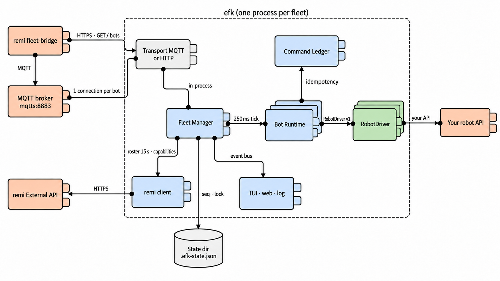

### Layered (Tier & Layer) View

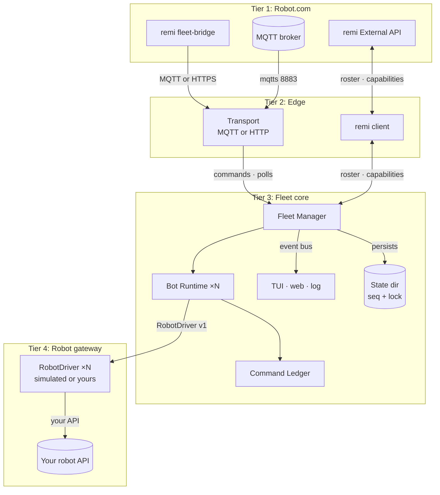

#### Tier 1: Robot.com

- **fleet-bridge**: sends commands and reads states.
- **MQTT broker**: carries `state`, `event` and `command` topics in MQTT mode.
- **External API**: fleet configuration, roster, capabilities and test deliveries.

#### Tier 2: Edge

- **Transport**: the contract on the wire. MQTT: one connection per bot. HTTP: the partner endpoints behind a bearer token, `/healthz`, optional push.
- **remi client**: bearer `REMI_API_KEY`, problem+json parsing, cursor pagination.

#### Tier 3: Fleet core

The Fleet Manager, one Bot Runtime per bot, the Command Ledger, the observers and the state directory the core persists `seq` and the lock to. This tier is the contract: idempotency, `seq`, the echo, cadence. It only sees the `RobotDriver` interface (`src/driver/robot-driver.ts`).

#### Tier 4: Robot gateway

Your driver (or the simulated one), the only code that talks to your robots.

### Deployment Structure

#### Deployment View

**You run the kit**, on a laptop, a VM or a container platform. One process per fleet.

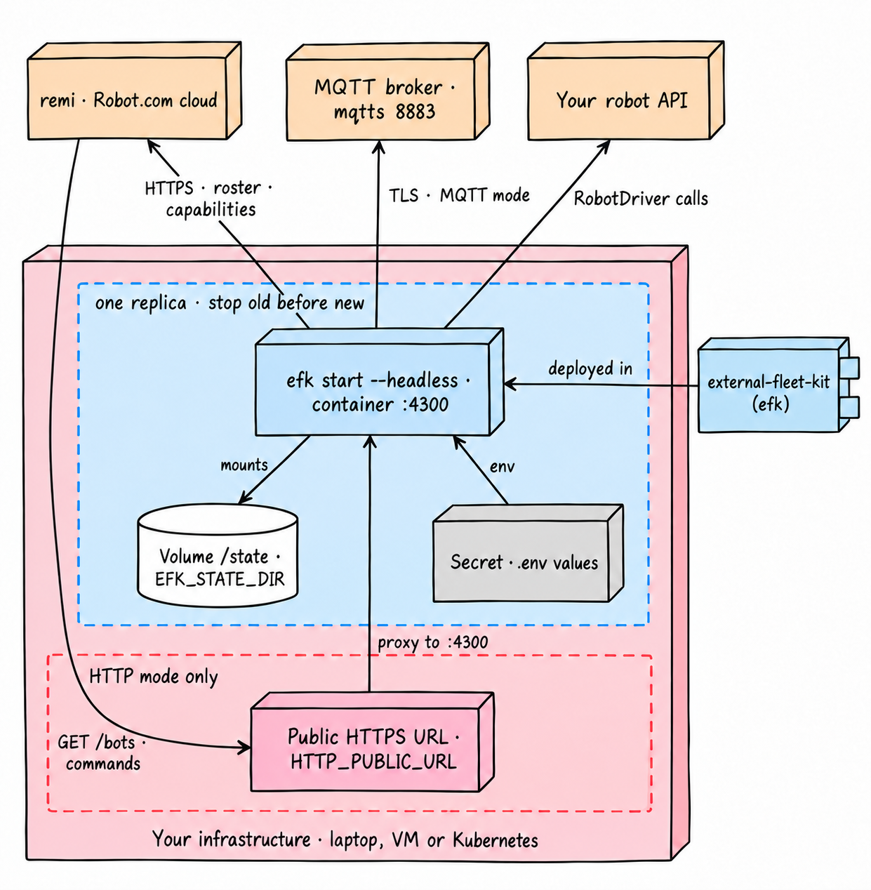

**Deployment units:**

| Unit | Value |
|---|---|
| Process | `efk start --headless` in a container, or `pnpm efk start` with the TUI on a laptop |
| Replicas | **exactly one** per fleet; stop the old one before starting the new (Kubernetes: `replicas: 1`, `strategy: Recreate`) |
| Image | `Dockerfile`: one image, `efk start --headless`, port `4300`, install with `--prod=false` |
| Volume | `EFK_STATE_DIR` (`/state` in the image) for `.efk.lock` and `.efk-state.json`; on Kubernetes a `ReadWriteOncePod` volume |
| Secrets | every variable of the `.env`, supplied as environment variables; the image has no `.env` |
| Network, MQTT mode | outbound TLS to the broker on 8883; nothing inbound |
| Network, HTTP mode | a public `https` URL (`HTTP_PUBLIC_URL`) that reaches the container's port; outbound HTTPS to remi |
| Health | `GET /healthz` without a token (HTTP mode) |

Details in [Running it in a container](#running-it-in-a-container).

### Decomposition Structure

#### Decomposition View

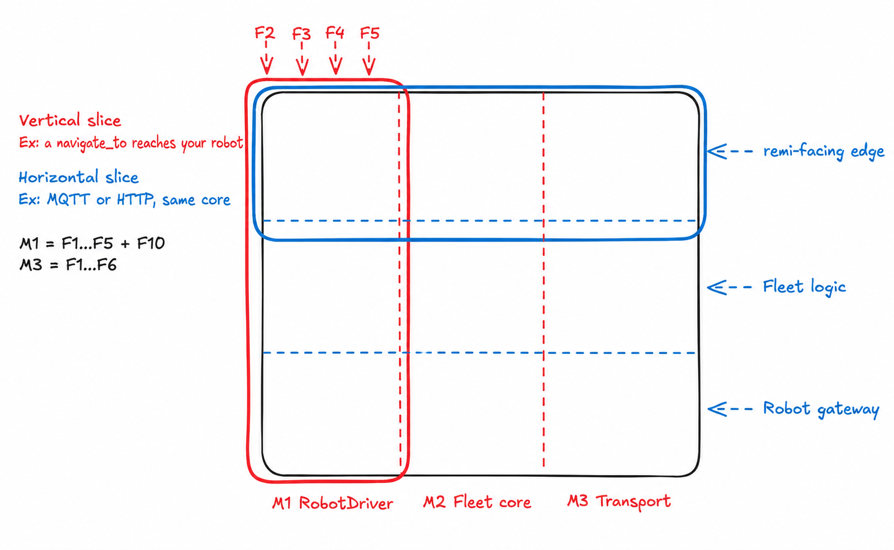

The formulas in the figure list the features each module implements. The matrix below also marks the modules a feature only passes through.

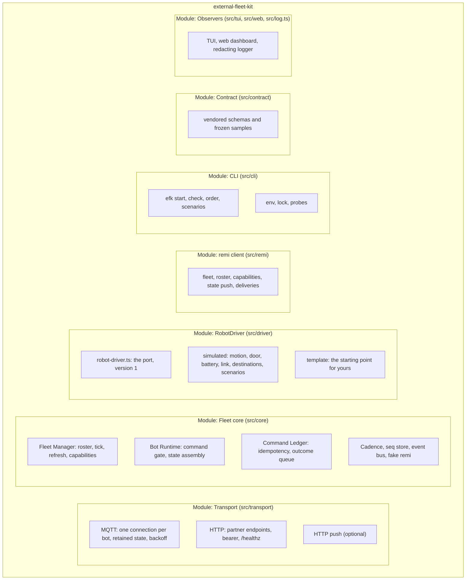

#### Functionalities Description

Which module takes part in which feature:

| | Transport | Fleet Manager | Bot Runtime | Ledger | RobotDriver | remi client | CLI | Contract | Observers |
|---|---|---|---|---|---|---|---|---|---|
| F1 state | X | X | X | X | X | | | X | X |
| F2 navigate | X | | X | X | X | | | | X |
| F3 cancel | X | | X | X | X | | | | X |
| F4 door | X | | X | X | X | | | | X |
| F5 outcomes | X | | X | X | X | | | | X |
| F6 resends | X | | X | X | | | | | |
| F7 live roster | X | X | | | X | X | | | |
| F8 idle start | | X | | | X | X | X | | |
| F9 capabilities | | X | X | | X | X | | | |
| F10 simulation | | | | | X | | X | | X |
| F11 `efk check` | X | | | | X | X | X | X | |
| F12 `efk order` | | | | | | X | X | | |
| F13 observability | | X | | | | | X | | X |

## 4. Quality Properties

Every mechanism below exists because a real integration needed it.

### Reliability Scenarios

#### remi resends a command

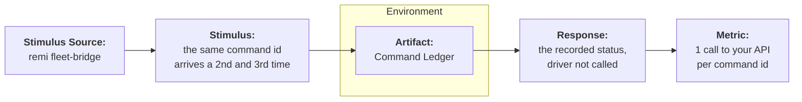

| Part | Detail |
|---|---|
| **Stimulus** | remi sends a command whose `id` the kit has already seen. |
| **Source of stimulus** | remi's resend policy: the same `id` every 10 s, up to 3 sends, until it appears in `current_command`. |
| **Artifact** | The Command Ledger of that bot. |
| **Environment** | Any: a lost echo, a slow network, a restart of remi's side. |
| **Response** | The ledger returns what it recorded the first time. `accept()` and `reject()` on a known id record nothing; the driver is not called again. |
| **Response metric** | Your API sees each command once, however many times remi sends it. |

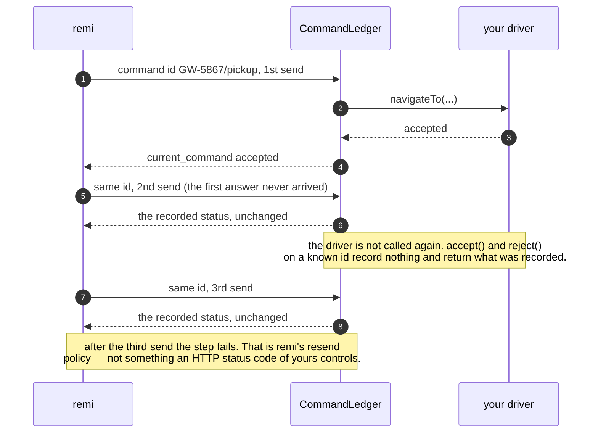

#### Your API refuses a command for good

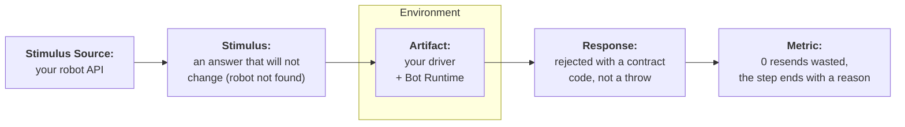

| Part | Detail |
|---|---|
| **Stimulus** | Your API answers a command with an error that is the same on every attempt: robot not found, idempotency key reused, action not supported. |
| **Source of stimulus** | Your robot API. |
| **Artifact** | Your driver's answer, read by the Bot Runtime. |
| **Environment** | A delivery step in progress. |
| **Response** | The driver returns `rejected` (`UNSUPPORTED_COMMAND` when no other code fits), which closes the command. Only what a resend can fix is thrown: a throw answers `503 DRIVER_ERROR` in HTTP and leaves `current_command` untouched in MQTT, so remi resends the same id. |
| **Response metric** | A deterministic failure costs no resends and the delivery gets a terminal status. A deterministic failure thrown instead gets the same answer on all three sends, and the delivery dies with no outcome. |

#### The link to a robot drops, or flaps

| Part | Detail |
|---|---|
| **Stimulus** | A robot's link is lost, or goes up and down. |
| **Source of stimulus** | Your network or your robot. Reproduce it with the `offline-flapping` scenario or the `o` key in the TUI. |
| **Artifact** | The driver's `connected`, and in MQTT mode the bot's own broker connection. |
| **Environment** | Any. |
| **Response** | The state says `connected: false`; in MQTT the bot's connection really closes and reconnects with exponential backoff (1 s doubling to 60 s, ±20 % jitter, so a whole fleet does not reconnect in step). An established connection that drops is treated like a refused CONNECT: end it, wait out the backoff, connect again. |
| **Response metric** | remi shows `blocked_by: ["disconnected"]` and never assigns the bot; a running job survives if the bot is back before the engine's timeout. |

#### The roster changes while robots are driving

| Part | Detail |
|---|---|
| **Stimulus** | Robot.com registers, retires or remaps (`fleet_serial`) a bot. |
| **Source of stimulus** | An operator in remi. |
| **Artifact** | The Fleet Manager's roster loop (`ROSTER_REFRESH_MS`, 15 s). |
| **Environment** | Other bots mid-delivery. |
| **Response** | Every 15 s the kit reads `GET /api/v3/fleet` and `GET /api/v3/fleet/bots` again. Only the bots that changed are rebuilt. A refresh never parks a fleet that is already driving (an undriveable bot is skipped and logged) and never rebuilds a bot that is running a command (the change waits for the next pass). If remi is unreachable the pass is skipped and the current roster keeps driving. |
| **Response metric** | A new bot is driven within 15 s, with no restart and no effect on the bots already delivering. |

#### The process restarts

| Part | Detail |
|---|---|
| **Stimulus** | The kit restarts: a deploy, a crash, a reboot. |
| **Source of stimulus** | Your infrastructure. |
| **Artifact** | The `seq` store (`.efk-state.json` in `EFK_STATE_DIR`). |
| **Environment** | Pushed states (MQTT or HTTP push), where remi keeps the highest `seq` it has accepted. |
| **Response** | The counters reach disk on a 1 s debounce and on every orderly stop, atomically. A restart continues from where it was. |
| **Response metric** | No state is discarded as old after a restart. A crash loses at most one second of counters. A counter that restarted from 1 would make remi discard every state that follows. |

### Availability Scenario: an idle start

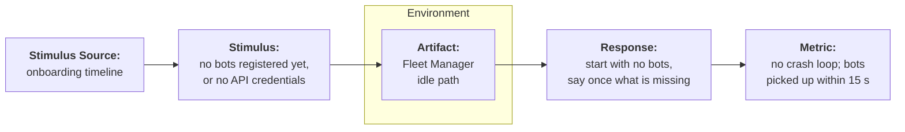

| Part | Detail |
|---|---|
| **Stimulus** | `efk start` with an empty roster, a bot without the `fleet_serial` its fleet requires, or a driver whose `DriverFactory.unavailable()` answers a sentence (typically: your API credentials are missing). |
| **Source of stimulus** | The normal order of an onboarding: bots are registered in remi on the day, and your credentials arrive when they arrive. |
| **Artifact** | The Fleet Manager's idle path. |
| **Environment** | A fresh deployment. |
| **Response** | The fleet comes up with no bots, says once what is missing, and publishes nothing. An empty roster fills itself within 15 s of Robot.com registering the bots. A driver that reports itself unconfigured needs the `.env` fixed and a restart. |
| **Response metric** | No refusal to start and no error per robot. |

### Consistency Scenarios

#### Two instances for the same fleet

| Part | Detail |
|---|---|
| **Stimulus** | A second `efk start` for the same fleet. |
| **Source of stimulus** | A second terminal, a rolling update, a scale-up. |
| **Artifact** | `.efk.lock`, created with an exclusive create (`wx`); a lock whose owner process is dead is taken over. |
| **Environment** | One machine, or a container platform. |
| **Response** | The second process refuses to start. **The design is single-instance**: two replicas would each keep their own `seq` counters and command ledger, and remi would discard half the states as stale and see commands its sender never accepted. Deploy one replica with a strategy that stops the old one before starting the new (Kubernetes: `replicas: 1`, `strategy: Recreate`, and a `ReadWriteOncePod` volume — `ReadWriteOnce` limits by *node*, not by pod). |
| **Response metric** | Never two writers of the same `seq`. |

#### An idle fleet and the capabilities document

| Part | Detail |
|---|---|
| **Stimulus** | The fleet has no bots to build capabilities from: idle start, every bot retired. |
| **Source of stimulus** | The roster. |
| **Artifact** | The Fleet Manager's capabilities step. |
| **Environment** | Any. |
| **Response** | Nothing is sent. A document is sent at start and again only when it changed, and never from an idle fleet. The document remi already holds stays in force. |
| **Response metric** | remi never receives `has_door: false` from an empty fleet. Such a document makes remi drop every `set_door` and turn `manual_close_door` on for every bot, one-way. |

### Security Scenarios

#### Unauthenticated calls in HTTP mode

| Part | Detail |
|---|---|
| **Stimulus** | A request to the partner endpoints without the right token. |
| **Source of stimulus** | Anyone who can reach `HTTP_PUBLIC_URL`. |
| **Artifact** | The HTTP transport's bearer guard (`src/transport/http/server.ts`). |
| **Environment** | HTTP mode, exposed on a public `https` URL. |
| **Response** | The `Authorization` header is compared as a SHA-256 digest in constant time; anything else gets `401`. `GET /healthz` is the only open route and returns `{"ok":true}`. |
| **Response metric** | Zero routes that read or change a bot without the token. |

#### The web dashboard on a network interface

| Part | Detail |
|---|---|
| **Stimulus** | `efk start --web --web-host 0.0.0.0`. |
| **Source of stimulus** | You, to see the dashboard from another machine. |
| **Artifact** | `src/web/index.ts`: the manual fault control routes. |
| **Environment** | A laptop or a server on a shared network. |
| **Response** | The read-only views are served, with a warning that bot state is visible to the network. The four control routes (`POST /api/bots/:botId/controls/*`) are **only mounted when the dashboard binds to loopback**; on any other host they do not exist (a request 404s, it is not "present but refused"). The routes are documented here and in the source, so a startup warning would protect nothing: whoever reaches the port could flip a bot's availability or link. |
| **Response metric** | No way to drive a bot's simulated faults from outside the machine. |

#### Credentials in logs, and in what remi receives

`efk start` builds the logger with the three credentials from your `.env` (`REMI_API_KEY`, `MQTT_PASSWORD`, `HTTP_TOKEN`) and redacts two ways: by **key** — `authorization`, `password`, `token`, `apiKey`, `secret` and the `.env` names, matched at any depth and ignoring case, `_` and `-` — and by **value**, replacing every spelling those three secrets can take in serialized text (raw, JSON-escaped, `encodeURIComponent`, `encodeURI`, form-encoded, and base64 at all three byte alignments, which is what catches a password inside an `Authorization: Basic` blob).

**It is not only a logging path.** Redaction happens once, at the event bus, and the fleet manager republishes driver events **to remi** off that same bus — emitting before it publishes. So what remi receives is the redacted copy, `detail` included, and `detail` comes straight from your driver. Anything the redactor changes here, it changes on the way out.

Because of that it is fail-closed, and fail-closed means it can over-redact. Three cases, all deliberate:

- **A secret shorter than 4 characters is dropped from value scrubbing entirely.** A needle that short matches so much innocent text that it would blank whole lines. A 3-character credential is a provisioning bug to fix, not something to redact around.
- **A password that is an ordinary word blanks that word everywhere.** Value scrubbing is substring replacement over already-serialized text; it has no way to know which occurrence was the credential. If your `MQTT_PASSWORD` is `robot`, every `robot` in every log line — and in every event `detail` republished to remi — becomes `[redacted]`. Use a random broker password.
- **Anything nested deeper than 12 levels is replaced wholesale** with `[redacted]`, rather than passed through unexamined. A reference pointing back into its own ancestry becomes `[circular]`; a shared reference that sits inside the bound is preserved in full, not collapsed.

If a log line or an event `detail` looks mangled, one of those three is why. The kit is not broken.

Your own API's credentials are not in the value-scrub list: keep them out of the messages your driver logs or emits.

### Known limits

- **The command ledger lives in memory.** Only `seq` survives a restart. A navigation your robot is still executing after a restart no longer appears in `current_command`, so remi cannot cancel it before sending another destination. Restart when your robots are idle.
- **`GET /healthz` answers 200 unconditionally.** The process is listening, nothing more: an idle fleet with no credentials answers the same as a working one.
- **One process per fleet, 200 bots at most per poll.** The contract caps an unpaginated `GET /bots` at 200 bots; a larger fleet is onboarded as more than one partner account.
- **A `throw` leaves no record.** That is what makes it retryable, and also why a deterministic failure must be a rejection (see above).

## 5. Interoperability Analysis

How remi, the kit and your robots talk to each other.

### Interfaces

- **remi → kit**: the External Fleets contract. MQTT mode: the `command` topic of each bot. HTTP mode: `GET /bots`, `POST /bots/:bot_id/commands`, `GET /bots/:bot_id/commands/*`, `POST /destinations/validate`, plus `GET /healthz`.
- **kit → remi**: MQTT mode: the `state` and `event` topics of each bot. Both modes: `GET /api/v3/fleet`, `GET /api/v3/fleet/bots`, `POST /api/v3/fleet/capabilities`; HTTP push: `POST /api/v3/fleet/state` and `/events`; `efk order`: `POST /api/v3/delivery`, `GET /api/v3/delivery/:id`.
- **kit → your robots**: only through `RobotDriver` (`src/driver/robot-driver.ts`, version 1).

### Context

- **Data format**: JSON. What the kit **emits** is validated with strict schemas (an unknown key fails, because it would be the kit's bug); what remi **returns** is read with loose ones (remi may add fields).
- **Errors**: `application/problem+json` (RFC 7807) with a `code`.
- **Security**: `REMI_API_KEY` for remi's REST API; the broker credentials in MQTT mode; `HTTP_TOKEN` as the bearer remi sends you in HTTP mode.
- **Identity**: `bot_id` from remi's roster, with the fleet prefix. Your own id for a robot is either the bot id minus the prefix or remi's `fleet_serial` for that bot.

### Exposition

- **MQTT mode**: nothing inbound. The kit opens outbound TLS connections to the broker.
- **HTTP mode**: the partner endpoints on `0.0.0.0:HTTP_PORT`, reached by remi over a public `https` URL; every route behind the bearer token except `/healthz`.
- **Locally**: the web dashboard on `127.0.0.1:4310` with `--web`.

### Consumption

There is **no reply message**. remi sends a command; the answer travels back inside the next `BotState`, in `current_command`. This is the single thing most worth understanding before you write a driver:

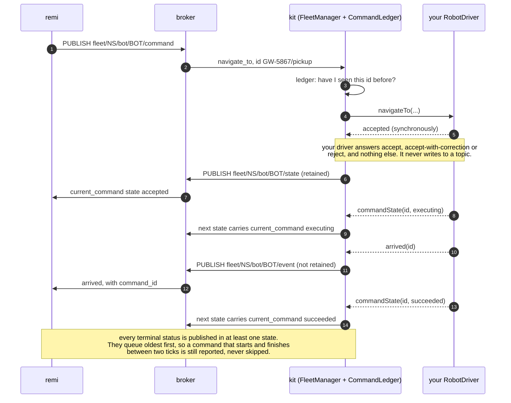

The gap between the command arriving and the first state that carries it is what the TUI calls the *echo*.

What `efk start` does, in order — note that the roster comes from remi, not from your config:

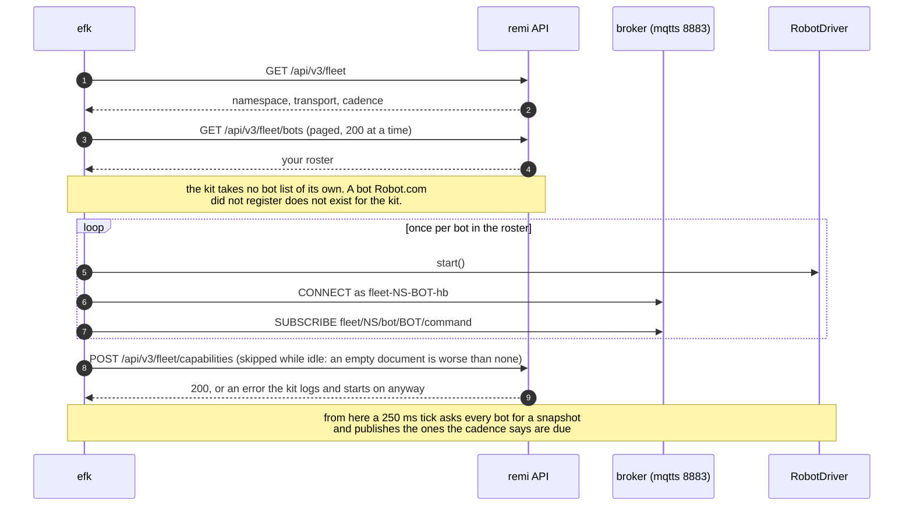

In HTTP mode the poll is the delivery: see [HTTP mode](#http-mode-and-the-public-url).

### Discovery

- **kit → remi**: `REMI_API_URL`; the broker from `MQTT_HOST` and `MQTT_PORT`.
- **remi → kit**: in HTTP mode, the base URL and token registered for your fleet (`HTTP_PUBLIC_URL`, `HTTP_TOKEN`).
- **Bots**: from remi's roster, re-read every 15 s. The kit takes no bot list of its own.

### Handling of the response

The contract's own rejection codes are the four `CommandStatus` allows on a `rejected`: `UNSUPPORTED_COMMAND`, `COMMAND_EXPIRED`, `BOT_BUSY`, `DESTINATION_UNREACHABLE`. Branch on those. In HTTP mode they are the status of the command call (`409` for `BOT_BUSY` and `COMMAND_EXPIRED`, `422` for the other two); in MQTT mode they arrive in `current_command` with `state: "rejected"`.

**Kit vocabulary that is not in the contract.** Three error codes in this kit are the kit's own. The contract does not declare them, another partner's fleet will not emit them, and remi attaches no behaviour to them. They exist because the contract leaves `error.code` free-form on a `failed` `CommandStatus` and constrains it only on a `rejected`.

| Value | Where you see it | What it means |
|---|---|---|
| `DRIVER_ERROR` | HTTP: the `code` of a `503` RFC 7807 body. MQTT: nowhere — `current_command` is left untouched | your driver threw. Never a `CommandStatus.state`, never a rejection code |
| `SUPERSEDED` | `error.code` on a `failed` status, for a navigation displaced by a newer `navigate_to` | the older command will not finish; the newer one owns the bot |
| `CANCELLED` | `error.code` on a `failed` status, for the navigation a `cancel_navigation` ended | the contract has no "cancelled" state, so the kit closes the entry itself rather than leave it `executing` for ever |

(`REPLACED` never leaves the process: it is the command ledger's internal marker, rendered on the wire as `SUPERSEDED`.)

**`correction_distance_m` means one thing in both cases: the distance from the destination you asked for to the nearest point this fleet can actually drive to.** Reachable → that point is the corrected one, so the number is the size of the correction. Unreachable → that point is the closest one inside the service area, so the number is how far past the edge the request fell. The service area is checked **after** the correction, because the corrected point is where the robot would stop.

## 6. Interoperability Scenario: a test delivery end to end

`efk order` creates a delivery on your sandbox and follows it until it is delivered. It is the same assigner that dispatches Robot.com's own fleet: nothing in this diagram is a path built for partners.

| Part | Detail |
|---|---|
| **Stimulus** | `efk order create --watch`. |
| **Source of stimulus** | You, with a key that has the `delivery` scope (C7). |
| **Artifact** | The whole chain: remi's assigner and engine, the transport, the kit core, your driver. |
| **Environment** | Your sandbox location, between `SANDBOX_PICKUP_EXTERNAL_ID` and `SANDBOX_DROPOFF_EXTERNAL_ID`. |
| **Response** | remi assigns one of your bots and sends `navigate_to`, `set_door`, the second leg and its `set_door`; the kit answers each through the state. |
| **Response metric** | The delivery reaches `delivered`. |

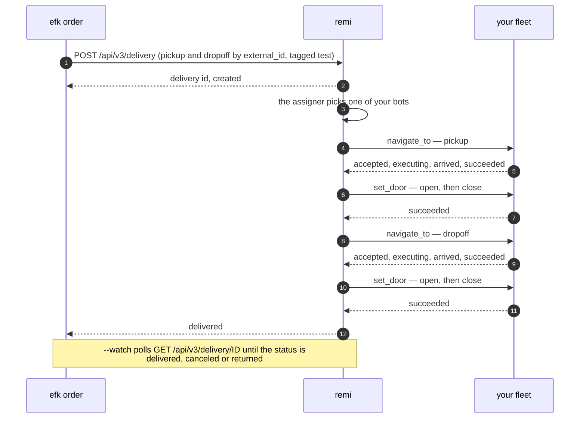

## 7. Architectural Styles

### Layered (N Tier)

Four tiers (Robot.com, edge, fleet core, robot gateway) with downward calls and callbacks upwards. The core speaks the contract up and `RobotDriver` down, and never sees your robot API.

### Publish-subscribe, or client-server

In MQTT mode remi and the kit never call each other: both publish and subscribe through the broker. In HTTP mode the kit is a server remi polls, and optionally a client that pushes. The core is the same in both: the transport is the only difference.

### Ports and adapters

`RobotDriver` is the port. The simulated driver, the template and your driver are adapters behind it.

### Event-driven, in process

Drivers emit `commandState`, `arrived` and `stateChanged`; the runtimes listen. Every event goes through one bus, which feeds the TUI, the dashboard and the log, and is also where redaction happens.

## 8. Architectural Patterns

### Idempotent receiver

The Command Ledger records the first answer to every command id and returns it for every resend.

### Transactional outbox, in memory

Terminal outcomes queue oldest first and are marked delivered only when a state carrying them has actually left. A command that starts and finishes between two ticks is still reported. The queue is bounded (`MAX_UNPUBLISHED_TERMINALS`, 200).

### Single writer

One process per fleet, enforced by an exclusive lock file. `seq` is persisted on a debounce.

### Exponential backoff with jitter

MQTT CONNECT retries double from 1 s to a 60 s ceiling, with ±20 % jitter applied before the clamp, so the ceiling is real and a fleet does not reconnect in step.

### Health endpoint

`/healthz` answers before the bearer guard so that probes, which send no headers, can reach it.

## 9. Usage

### `efk check` — does my integration meet the contract?

```
efk check [--json] [--demo]
```

Nine rules, each `PASS`, `WARN`, `FAIL` or `SKIP`, each with a plain-language fix. Exit code 1 on any `FAIL`. Read-only: it publishes nothing and creates nothing.

| # | Rule | What a FAIL means |
|---|---|---|
| C1 | `.env` parses and is complete | copy the file Robot.com sent you; the message names the missing variable. `MQTT_PASSWORD` arrives separately, so the commonest FAIL here is "it is empty: paste the broker credential" |
| C2 | `GET /api/v3/fleet` answers and matches your `.env` | 401: bad key · 403: key lacks `fleet` · 404 `FLEET_NOT_CONFIGURED`: Robot.com has not configured your fleet yet · transport or namespace mismatch (your `MQTT_USERNAME` implies a namespace remi does not agree with) · demo mode active · WARN if the contract version differs from the kit's |
| C3 | roster is non-empty, ids are well-formed, bots sit in your sandbox location (only checked when `SANDBOX_LOCATION_ID` is set); judged on the same selection `efk start` drives (retired rows out, `max_bots` applied) | 0 bots: Robot.com has not registered them yet · the fleet requires `fleet_serial` and a bot has none · WARN per bot not yet placed |
| C4 | `blocked_by` per bot, explained | never FAIL: only meaningful while `efk start` runs (`efk start --check` runs it after 10 s) |
| C5 | MQTT CONNECT + SUBSCRIBE with a diagnostic client id (`fleet-<ns>-check-<random>-hb`) | credential or client id refused · WARN if the broker downgraded the subscription to QoS 0 |
| C6 | HTTP mode: `GET HTTP_PUBLIC_URL/bots` with your token returns every bot | always at most WARN: this proves your server is up, **not** that remi can reach it |
| C7 | the key has the `delivery` scope (`GET /api/v3/delivery/?limit=1`) | WARN: you can simulate but `efk order` will not work; ask Robot.com |
| C8 | the frozen samples still validate against the vendored schemas | the kit itself is inconsistent; open an issue |
| C9 | `efk.config.ts` loads; a driver is built **for every bot in your roster**, with the same `fleetSerial` `efk start` passes (never started; SKIP while the factory's `unavailable()` says it cannot build yet) and each is `driverVersion: 1`, declares capabilities and `validateDestination` | update your driver to v1 · WARN if a driver declares a door but not `set_door`, or if a scenario override names a bot you do not have |

Paste the nine lines into any support request. `--json` prints the same report as JSON — it contains no secrets, so it is safe to attach.

### `efk start` — run the fleet

```
efk start [--scenario <name>] [--web] [--web-host <host>] [--headless] [--check] [--demo]
```

- One MQTT connection per bot (client id `fleet-<ns>-<bot_id>-hb`), retained `state`, `event` unretained, `command` subscribed — exactly as the contract's *MQTT mode* section asks. Capabilities are not a topic: the kit sends the document to remi at start-up, and again only when the fleet changes it.
- The TUI shows **BOTS** (link, availability, battery, door, current command, age of last state, `seq`, dropped states), **COMMANDS** (newest first; resends of the same id are one row with `×N`; the *echo* column is the time from receiving a command to publishing the first state that carries it in `current_command`), **EVENTS** and **LOG**. `Tab`/`←`/`→` switch sections, `↑`/`↓` select a bot, `q` quits.
- Manual fault keys on the selected bot (simulated driver only): `a` toggle `available`, `d` open/close the door locally (the human of `manual_close_door`), `o` cycle the link (scenario → pinned down → pinned up → back to the scenario; a `*` in the row means you are holding it), `b` blocked/unblocked.
- `--web` serves the same four views at `http://127.0.0.1:4310` (SSE, no framework, no map), plus the same manual fault controls the TUI has — available/door/link/blocked — as four `POST /api/bots/:botId/controls/*` routes. This is a deliberate break of design §8 ("TUI, web and log are observers of the bus; no logic lives in them"): the TUI already broke it (manual fault keys), and the web now does too, on purpose, sharing the same extracted logic (`src/core/manual-controls.ts`) so the two interfaces cannot diverge. It binds to loopback by default, and the control routes exist only on loopback (see [Security Scenarios](#the-web-dashboard-on-a-network-interface)). `--web-host 0.0.0.0` still exposes the read-only views and warns that state is visible to the network.
- `--headless` disables the TUI (Docker, CI) and every line the running fleet produces goes to stderr as JSON — one per event, not just the startup banner. The few sentences that *refuse* a start (an unparseable `.env`, a held lock, a port already taken) and the demo banner stay plain prose, because there is no fleet yet to report on.
- A second `efk start` in the same directory refuses to run (`.efk.lock`). The design is single-instance: see [Consistency Scenarios](#two-instances-for-the-same-fleet).
- **An empty roster, or a driver that is not configured yet, is an idle start, not a refusal.** See [the idle start](#availability-scenario-an-idle-start).

**The roster is not frozen at startup.** Every 15 s the kit follows what changed in remi: a bot Robot.com registered starts being driven, a bot they retired stops, and a bot whose `fleet_serial` moved is rebuilt against the robot it now names (see [the roster scenario](#the-roster-changes-while-robots-are-driving)). The capabilities document is re-sent only when it changed, and never from an idle fleet. What still needs a restart is the `.env`: credentials and transport are read once, by design.

**`fleet_serial`.** remi may map a bot to the id your own system uses for that robot (`fleet_serial` on each roster row). The driver factory receives it as `env.fleetSerial`; `null` means the original rule, where your serial is the bot id minus the fleet prefix. When remi marks the fleet `requires_fleet_serial` — its bot ids are internal, so stripping the prefix would address the wrong robot — a bot with no mapping parks the whole fleet at start (idle, said once), rather than driving 49 robots of 50 and stranding the order that lands on the missing one. A refresh only skips it.

### `efk order` — create a test delivery

```
efk order create [--name <n>] [--watch]
efk order watch <delivery id>
```

Creates a delivery on your sandbox between `SANDBOX_PICKUP_EXTERNAL_ID` and `SANDBOX_DROPOFF_EXTERNAL_ID` (tagged `test`), and follows it until `delivered`. Needs the `delivery` scope (C7) and `SANDBOX_LOCATION_ID`. Watch the TUI: `navigate_to` → `accepted` → `executing` → `succeeded`, `set_door`, the second leg, `delivered`. The full sequence is in [section 6](#6-interoperability-scenario-a-test-delivery-end-to-end).

### Scenarios — what each knob reproduces

`efk start --scenario <name>` loads `scenarios/<name>.json`. `{}` is the default: bots online, available, 100 %, full door, they arrive and echo. Every field has a default; `overrides` are per bot id, and an override only changes the keys it mentions — siblings at every level are kept.

> **The bundled scenarios use our example fleet's ids (`ACME-0001`…).** Your roster is almost certainly different, and an override keyed on a bot you do not have does nothing at all. Edit the ids to match yours. `efk start` warns about stray ids at startup and `efk check` C9 lists them.

| Knob | Reproduces | What you see in the kit | What you should see in remi |
|---|---|---|---|
| `link.mode: offline` | link to the robot lost | `connected: false`; in MQTT the bot's connection really closes | `blocked_by: ["disconnected"]`, never assigned |
| `link.mode: flapping` | intermittent link | connection up/down every `flapPeriodMs` | `connected` alternates; a running job survives if the bot is back before the engine's timeout |
| `battery.startPct: 15` | low battery | `battery.percentage: 15` | `blocked_by: ["battery_below_minimum"]`; exactly 20 is still eligible |
| `battery.unavailableBelowPct: 30` | you pull the bot before remi does | `available: false` past the threshold | `blocked_by: ["unavailable"]` |
| `door.mode: boolean` | a lid that only says open/closed | door jumps `closed` → `opened`, no transients | remi's bridge synthesises `opening`/`closing`; load/unload completes |
| `door.mode: stalled` | jammed door | the door reports `stalled` on the next tick after `set_door` and stays there — it jams the instant it is asked to move, it does not time out first | the door step fails immediately |
| `door.mode: ignore` | door does not react | no state change | remi's 25 s door timeout, then an operator task |
| `door.hasDoor: false` | no door | `door: "unsupported"`, `has_door: false` | remi never sends it `set_door` |
| `motion.arrive: never` | arrives to 1 m and never confirms | `executing` forever, 1 m short | the job does not advance until remi's position fallback, if the location has it enabled (25 m radius, the bot stopped; it needs `motion.speed_mps`, which the simulated driver sends) |
| `motion.arrive: stall` | gives up mid-route | stops at 60 % | `step-bot-not-moving` or a step timeout |
| `motion.ackGoals: false` | lost echo | command never appears in `current_command`; the bot still moves | remi resends the same id every 10 s, 3 sends in total, then fails the step; the TUI groups the three |
| `fleet.supportsCommandInterrupt: false` (in `efk.config.ts`) | API that rejects a second mission | second `navigate_to` while executing → `BOT_BUSY` | remi sends `cancel_navigation` first, waits for the navigation to end, then the new `navigate_to` (see the note below) |
| `destinations.snapGridDeg: 0.0002` | you correct destinations onto your drivable network | `accepted_with_correction` (only when the point actually moved), `distanceM` 0–15 m | HTTP: 202 with `corrected_position`; MQTT: `current_command.corrected_position`; remi records it against the point, does not resend |
| `destinations.unreachableBeyondM: 300` | destination out of service area (measured from the sandbox centre, so the answer is idempotent) | `rejected: DESTINATION_UNREACHABLE` with `correctionDistanceM` | HTTP 422 / MQTT `current_command.state: "rejected"` with `error.code` and `correction_distance_m`; remi fails the step, alerts an operator, does not retry |
| `motion.noise.*: 0` | a "perfect" robot | exact track at 1.5 m/s | good for ETA measurements |

> ### `supports_command_interrupt: false` — remi cancels first
>
> remi reads this from the capabilities document the kit sends at start; with no document on file it assumes `false`. For a fleet that declares `false`, a new `navigate_to` for a bot whose navigation is still `accepted` or `executing` is preceded by a `cancel_navigation` (id `cancel/<the new goal's id>`). remi waits up to **10 s** for `current_command` to stop showing the running navigation as `accepted` or `executing`, then sends the new goal.
>
> So declare `false` only if your API genuinely rejects a second mission while one is running, and make `cancelNavigation` end the running command quickly — the kit closes it as `failed` with `CANCELLED` as soon as your driver accepts the cancel. If the cancel has not landed after 10 s, the new `navigate_to` goes out anyway and is answered `BOT_BUSY`. A wrong `true` strands a job: remi sends the new goal straight away and expects it to replace the running one.

Shipped scenarios: `default`, `boolean-door`, `low-battery`, `offline-flapping`, `never-arrives`, `no-interrupt`, `destination-correction`. `efk scenarios list` prints them, one line each, with what each one does.

**`no-interrupt` is deliberately inert.** Parsed, that file is identical to `default`: the knob its name promises — `supports_command_interrupt` — is a *fleet* capability that lives in `efk.config.ts`, not a per-bot scenario field, so there is nothing for the JSON to say. It is kept, and named, because that is where a partner looks for it. `efk scenarios list` prints the same explanation next to it. To see the behaviour, set `fleet.supportsCommandInterrupt: false` in `efk.config.ts` — and read the note above first.

### Demo mode

```
efk start --demo            # or EFK_FAKE_REMI=1 efk start
```

Runs the whole kit — TUI, dashboard, simulated bots, scenarios — against a **fake roster** (`ACME-0001`…`ACME-0003`) that never talks to remi. It exists so you can see what the tool looks like before your credentials arrive, and so a demo does not need a live sandbox.

It is a **supported mode, not a production one**, and it says so everywhere it could possibly mislead you:

- a red banner at the top of the TUI and of the web dashboard;
- a `DEMO MODE — not connected to remi` line in the log at startup;
- `efk check --demo` reports **C2 as FAIL**, so the command can never exit 0 in demo mode.

Nothing you see in demo mode is evidence of anything: no bot is registered, no delivery is created, no state reaches remi.

### From simulator to your robots: implementing `RobotDriver`

1. Copy `src/driver/template/my-robot-driver.ts` to `src/driver/my-robot-driver.ts` and replace each `TODO` with calls into your fleet API.
2. In `efk.config.ts` replace `driver: simulated({ scenario: ... })` with `driver: (botId) => new MyRobotDriver(botId)`. The factory's second argument carries `fleetSerial` (see [`efk start`](#efk-start--run-the-fleet)), and the factory may have an `unavailable()` that answers a sentence while it cannot build drivers — missing API credentials — so the fleet starts idle instead of throwing once per robot.
3. `pnpm efk check` (C9 validates your driver), then `pnpm efk start`.

The contract of the interface (`src/driver/robot-driver.ts`, version 1):

- `snapshot()` is called four times a second and must be cheap. Return `position: null` while you do not know where the robot is: the kit will not publish a state without a position (remi would score it), and counts the drop. **Do not repeat an old fix as current**: every state goes out with the kit's timestamp, so a cached position reads to remi as "connected, right here" for as long as you keep returning it. Hold it through a short telemetry gap, then return `null` or `connected: false`.
- `available` is your API's own "can take work", one to one. Do not fold connectivity or the age of your reading into it: remi derives both on its side, and a third opinion only creates disagreement.
- Optional snapshot fields: `speedMps` travels as `motion.speed_mps` (remi uses it to see that a bot has stopped), `azimuth` (compass bearing, degrees from North, clockwise) as `position.azimuth`, and `outOfService` as `out_of_service` (it does not make the bot unavailable: remi keeps assigning it and alerts its operators while it carries a job; the alert clears when it goes back to `false`). Leave them out if your API cannot tell; the kit then leaves them out of the state.
- `navigateTo`, `cancelNavigation`, `setDoor` answer **synchronously** with `accepted`, `accepted_with_correction { position, distanceM }` or `rejected { code, message }`; then emit `commandState(id, 'executing' | 'succeeded' | 'failed')` and `arrived(id)`. Never call back with an id you did not accept.
- Idempotency, `seq`, `current_command`, cadence, transport, retries: **not yours**. The kit never sends the same command id to your driver twice.
- `validateDestination(position)` answers `POST /destinations/validate` in HTTP mode. The default returns the point unchanged; override it if your network snaps destinations. remi does not call this endpoint in the current release (the point registry that used it was retired), so nothing depends on it today.
- `supports_command_interrupt` is fleet-wide, in `efk.config.ts`. Declare `false` if your API rejects a second mission while one runs; remi then cancels before re-sending (see the note under [Scenarios](#scenarios--what-each-knob-reproduces)). A wrong `true` strands a job.
- A `throw` from any method is reported as `DRIVER_ERROR`. **This is an extension of this kit, not part of the contract**: the External Fleets page declares no such code and states no policy for 5xx. What it does say is that remi sends a command up to **3 times**. So a `throw` means *no answer*: HTTP gets a 503 whose body carries `"code": "DRIVER_ERROR"`, and in MQTT `current_command` is left untouched — in both cases remi simply resends the same `id` under its existing resend policy, and after the third send the step fails. Do not read the 503 as "remi will retry because of the status": it retries because of the resend policy, and only twice more.
- **Throw only what a resend can fix.** That follows from the previous point: a transient refusal of your API ("busy, retry", a request with that key still in progress, a timeout) and your own bugs are throws. A failure that is deterministic for that command — robot not found, idempotency key reused, action not supported — gets the same answer on all three sends and the delivery dies with no terminal `current_command`. Return `rejected` for it (`UNSUPPORTED_COMMAND` when no other code fits) with your API's error in the message.
- **Your API's idempotency may not be uniform, and the kit cannot hide that.** The kit never hands your driver the same command twice, but your driver may retry its own calls. Check each endpoint: it is common for "create mission" to replay a repeated key while "cancel" or "open lid" act on it again, or for a check endpoint not to take a key at all. Likewise, an action the robot never confirms (a lid that reports nothing back) is not done because the call returned 2xx: read the result from telemetry.
- **Log your API's mission id next to remi's command id.** When an outcome looks wrong — "succeeded" far from the destination — that id is the only thing your own support can look up.

### HTTP mode and the public URL

Set `REMI_TRANSPORT=http`. The kit serves the four partner endpoints (`GET /bots`, `POST /bots/:bot_id/commands`, `GET /bots/:bot_id/commands/:command_id`, `POST /destinations/validate`) on `0.0.0.0:HTTP_PORT` with your `HTTP_TOKEN`, answers 202 (never 200) and RFC 7807 errors. `GET /healthz` is the one unauthenticated route (see [Running it in a container](#running-it-in-a-container)). Capabilities are not one of these: the kit sends that document to remi with `POST /api/v3/fleet/capabilities` (see [`efk start`](#efk-start--run-the-fleet)), not served or polled. **remi has to reach `HTTP_PUBLIC_URL` over `https`**: a laptop needs a tunnel or a deployment. C6 can only tell you that your server is up; it cannot prove remi reaches it, which is why it is a `WARN` even when green. `HTTP_PUSH=true` pushes state and events to remi instead of waiting to be polled.

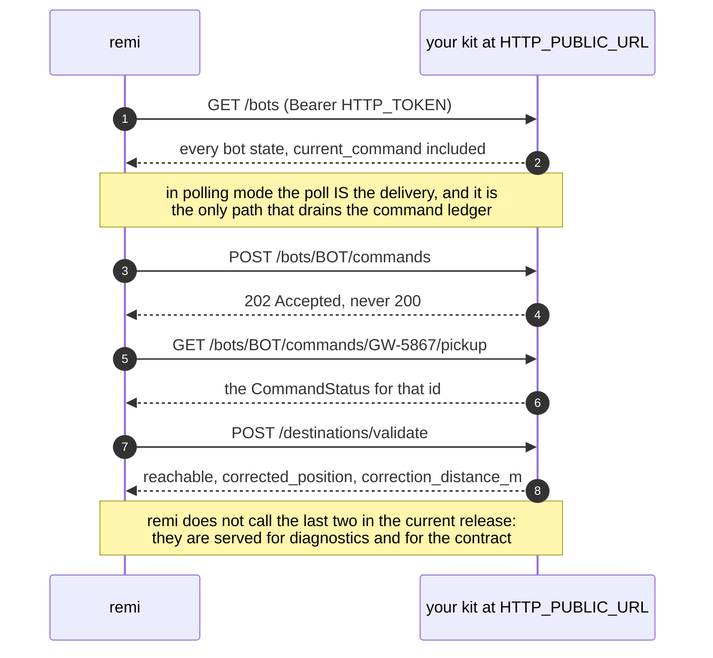

One shape to copy rather than re-derive: remi forms a command id as `<job id>/<step>` (`GW-5867/pickup`), so **a command id contains a slash**. The status route is therefore a wildcard (`/bots/:bot_id/commands/*`) and the id is the rest of the path, read with no second `decodeURIComponent` — decoding twice turns a `%2F` that is genuinely part of an id into a separator.

### Running it in a container

`docker build -t my-fleet:dev .` builds one image that runs `efk start --headless` on port `4300`. The install is `--prod=false` on purpose: the kit has no build step, it runs on `tsx`, which is a devDependency, and a production install gives an image that cannot execute a line.

There is no `.env` in the image. Every variable of [the `.env` you receive](#the-env-you-receive) is read from the environment (`efk` merges `process.env` over the file, and the file is simply absent), so the deployment supplies them as a secret. One variable matters most here:

- **`EFK_STATE_DIR`** (`/state` in the image) — where `.efk.lock` and `.efk-state.json` are written. `/app` is immutable, and the `seq` counters must survive a restart: a counter that resets to 1 makes remi discard every state that follows as older than what it already has. Mount a volume there.

The entrypoint removes a leftover `.efk.lock` before starting. Its owner-is-alive check cannot work across containers — pid 1 always exists in a fresh one — so a lock left by a killed predecessor would refuse every restart for ever. That is safe **only** with one replica and a strategy that stops the old container first (see [Consistency Scenarios](#two-instances-for-the-same-fleet)); with two replicas the lock would be doing its job and deleting it would be the bug.

`GET /healthz` (HTTP mode) is served **without** the bearer token, because a load balancer's health probe usually sends no headers; every other route still requires it. It answers `{"ok":true}` **unconditionally**: the process is listening, nothing more. It is not a deployment gate — an idle fleet with no credentials answers the same 200 as a working one. Read the logs, or run `efk check`, to know whether the fleet is actually driving robots.

### How the contract is kept in sync

`src/contract/` is a vendored copy of the schemas on the contract page. What the kit **emits** is strict (an unknown key fails the parse, because it would be our bug); what remi **returns** is loose (remi adds fields, and a new one must not stop your fleet). `src/contract/samples/` freezes the page's JSON examples — **41 files: 40 extracted from the page plus one written by hand**, the hand-written one named `handmade__*` because the page publishes no 422 problem body — and `SOURCE.json` records the `commit` and the `sha256` of the `data.ts` they came from. The parity test proves the frozen samples still validate against the kit's schemas — it does **not** detect that the page changed. No CI checks that yet: Robot.com compares the `sha256` with the one recorded next to the page (`KIT_SYNC.json`) when the page changes, re-freezes with `pnpm sync-samples`, and publishes a new kit version. `efk --version` prints the kit version, the contract version and the source commit.

## 10. Testing

| Command | What it covers |
|---|---|
| `pnpm test` | `node:test` on `tsx`, no infrastructure: the core, the transports, the simulated driver, the CLI rules and the contract parity test |
| `pnpm typecheck` | `tsc --noEmit` |
| `pnpm check` | Biome |
| `pnpm efk check` | the nine contract rules against a live remi (read-only) |

The MQTT broker test runs only when `EFK_MQTT_URL` points at a broker. The CI runs `check`, `typecheck` and `test` on every push to `main` and every pull request.

## 11. Project Structure

```
external-fleet-kit/
├── src/
│   ├── cli/                 efk start / check / order / scenarios, env, lock, probes
│   ├── core/                Fleet Manager, Bot Runtime, Command Ledger, cadence, seq, events, fake remi
│   ├── driver/
│   │   ├── robot-driver.ts  the port your driver implements (version 1)
│   │   ├── simulated/       motion, door, battery, link, destinations, scenarios
│   │   └── template/        my-robot-driver.ts, the starting point for yours
│   ├── transport/
│   │   ├── mqtt/            one connection per bot, backoff
│   │   └── http/            partner endpoints, problem+json, push
│   ├── remi/                remi External API client
│   ├── contract/            vendored schemas, frozen samples, parity runner
│   ├── tui/, web/           the TUI and the web dashboard
│   └── log.ts               logger with redaction
├── scenarios/               the bundled scenarios
├── scripts/sync-samples.ts  re-freezes the contract samples from the page
├── test/                    MQTT transport and broker tests
├── docker/entrypoint.sh     removes a stale lock, runs efk start --headless
├── Dockerfile
├── efk.config.ts            your driver and fleet capabilities
└── docs/images/             the figures of this README
```

## 12. Public documentation

remi documents this kit and the sandbox at [`/docs/external-fleets/kit`](https://remi.kiwi/docs/external-fleets/kit), next to the [External Fleets contract](https://remi.kiwi/docs/external-fleets). That page says what this README says, in less space, and links here for detail. When they disagree, this README wins and the page gets corrected: today the page still says that remi does not handle `supports_command_interrupt: false`, which is no longer true (see [Scenarios](#scenarios--what-each-knob-reproduces)).

## 13. License

Apache-2.0 (see `LICENSE` and `NOTICE`).
